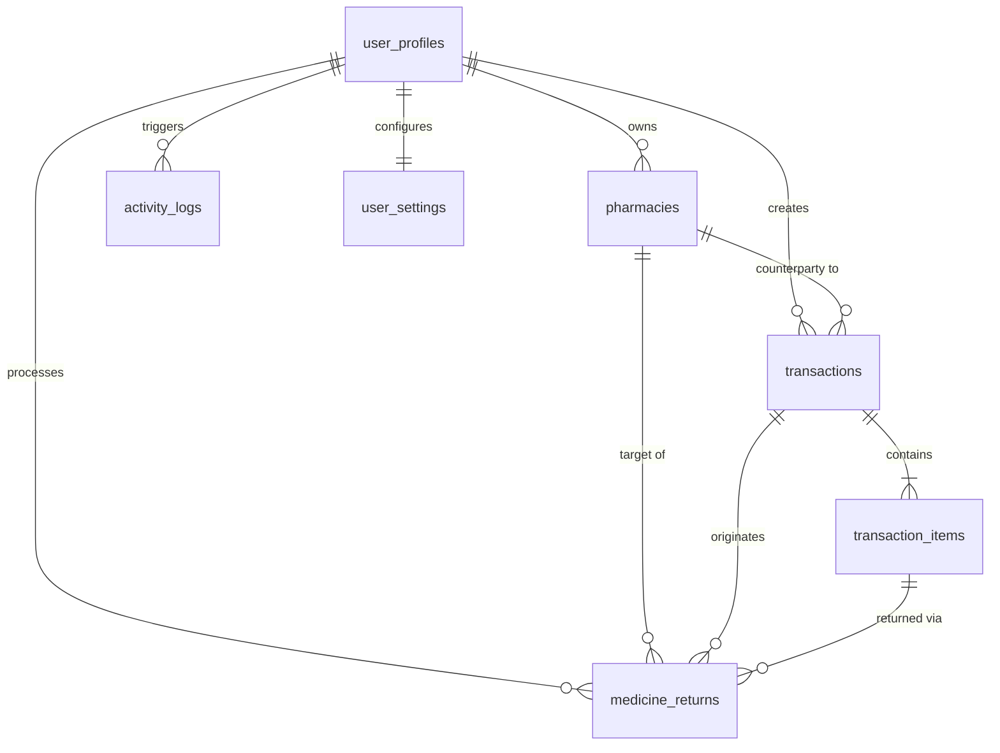

# Database Schema Specification

This document details the complete relational PostgreSQL database schema for **Pharmacy Khata**, hosted on Supabase with Row Level Security (RLS) enabled on all tables.

---

## 1. Architectural Highlights
- **Primary Keys:** UUID v4 (`gen_random_uuid()`)
- **Monetary Amounts:** `NUMERIC(12, 2)` (strictly avoiding floating-point imprecision)
- **Quantities:** `INTEGER` (non-negative constraints: `quantity > 0`)
- **Percentages:** `NUMERIC(5, 2)` (constrained between `0.00` and `100.00`)
- **Soft Deletion:** `deleted_at TIMESTAMPTZ DEFAULT NULL` on entity tables
- **Multi-Tenancy:** `user_id UUID NOT NULL REFERENCES auth.users(id) ON DELETE CASCADE`
- **Audit Logs:** Immutable audit log table populated via PostgreSQL triggers and API actions

---

## 2. Table Specifications

### 2.1 `user_profiles`
Stores profile metadata for authenticated users.

```sql
CREATE TABLE public.user_profiles (
    id UUID PRIMARY KEY REFERENCES auth.users(id) ON DELETE CASCADE,
    full_name TEXT NOT NULL,
    pharmacy_business_name TEXT,
    phone_number TEXT,
    address TEXT,
    created_at TIMESTAMPTZ NOT NULL DEFAULT timezone('utc'::text, now()),
    updated_at TIMESTAMPTZ NOT NULL DEFAULT timezone('utc'::text, now())
);
```

### 2.2 `pharmacies`
Stores contact and business information of counterparty pharmacies.

```sql
CREATE TABLE public.pharmacies (
    id UUID PRIMARY KEY DEFAULT gen_random_uuid(),
    user_id UUID NOT NULL REFERENCES auth.users(id) ON DELETE CASCADE,
    name TEXT NOT NULL,
    contact_person TEXT,
    phone_number TEXT NOT NULL,
    address TEXT,
    opening_balance NUMERIC(12, 2) NOT NULL DEFAULT 0.00,
    opening_balance_type TEXT NOT NULL CHECK (opening_balance_type IN ('payable', 'receivable', 'neutral')),
    notes TEXT,
    deleted_at TIMESTAMPTZ DEFAULT NULL,
    created_at TIMESTAMPTZ NOT NULL DEFAULT timezone('utc'::text, now()),
    updated_at TIMESTAMPTZ NOT NULL DEFAULT timezone('utc'::text, now())
);

CREATE INDEX idx_pharmacies_user_id ON public.pharmacies(user_id);
CREATE INDEX idx_pharmacies_name ON public.pharmacies(name);
CREATE INDEX idx_pharmacies_deleted_at ON public.pharmacies(deleted_at);
```

### 2.3 `transactions`
Master header for medicine exchange transactions.

```sql
CREATE TYPE transaction_type_enum AS ENUM ('received', 'given');

CREATE TABLE public.transactions (
    id UUID PRIMARY KEY DEFAULT gen_random_uuid(),
    user_id UUID NOT NULL REFERENCES auth.users(id) ON DELETE CASCADE,
    pharmacy_id UUID NOT NULL REFERENCES public.pharmacies(id) ON DELETE RESTRICT,
    invoice_number TEXT,
    transaction_date DATE NOT NULL DEFAULT CURRENT_DATE,
    type transaction_type_enum NOT NULL, -- 'received' (payable) or 'given' (receivable)
    notes TEXT,
    subtotal_amount NUMERIC(12, 2) NOT NULL DEFAULT 0.00 CHECK (subtotal_amount >= 0),
    discount_amount NUMERIC(12, 2) NOT NULL DEFAULT 0.00 CHECK (discount_amount >= 0),
    grand_total NUMERIC(12, 2) NOT NULL DEFAULT 0.00 CHECK (grand_total >= 0),
    deleted_at TIMESTAMPTZ DEFAULT NULL,
    created_at TIMESTAMPTZ NOT NULL DEFAULT timezone('utc'::text, now()),
    updated_at TIMESTAMPTZ NOT NULL DEFAULT timezone('utc'::text, now())
);

CREATE INDEX idx_transactions_user_id ON public.transactions(user_id);
CREATE INDEX idx_transactions_pharmacy_id ON public.transactions(pharmacy_id);
CREATE INDEX idx_transactions_date ON public.transactions(transaction_date);
CREATE INDEX idx_transactions_type ON public.transactions(type);
CREATE INDEX idx_transactions_deleted_at ON public.transactions(deleted_at);
```

### 2.4 `transaction_items`
Line items detailing individual medicines, quantities, retail prices, and discounts.

```sql
CREATE TABLE public.transaction_items (
    id UUID PRIMARY KEY DEFAULT gen_random_uuid(),
    transaction_id UUID NOT NULL REFERENCES public.transactions(id) ON DELETE CASCADE,
    medicine_name TEXT NOT NULL,
    quantity INTEGER NOT NULL CHECK (quantity > 0),
    retail_price NUMERIC(12, 2) NOT NULL CHECK (retail_price >= 0),
    discount_percentage NUMERIC(5, 2) NOT NULL DEFAULT 0.00 CHECK (discount_percentage >= 0 AND discount_percentage <= 100),
    discount_amount NUMERIC(12, 2) NOT NULL DEFAULT 0.00 CHECK (discount_amount >= 0),
    discounted_unit_price NUMERIC(12, 2) NOT NULL CHECK (discounted_unit_price >= 0),
    line_total NUMERIC(12, 2) NOT NULL CHECK (line_total >= 0),
    returned_quantity INTEGER NOT NULL DEFAULT 0 CHECK (returned_quantity >= 0 AND returned_quantity <= quantity),
    created_at TIMESTAMPTZ NOT NULL DEFAULT timezone('utc'::text, now()),
    updated_at TIMESTAMPTZ NOT NULL DEFAULT timezone('utc'::text, now())
);

CREATE INDEX idx_transaction_items_transaction_id ON public.transaction_items(transaction_id);
CREATE INDEX idx_transaction_items_medicine_name ON public.transaction_items(medicine_name);
```

### 2.5 `medicine_returns`
Tracks returns linked directly to original transaction line items.

```sql
CREATE TABLE public.medicine_returns (
    id UUID PRIMARY KEY DEFAULT gen_random_uuid(),
    user_id UUID NOT NULL REFERENCES auth.users(id) ON DELETE CASCADE,
    pharmacy_id UUID NOT NULL REFERENCES public.pharmacies(id) ON DELETE RESTRICT,
    transaction_id UUID NOT NULL REFERENCES public.transactions(id) ON DELETE RESTRICT,
    transaction_item_id UUID NOT NULL REFERENCES public.transaction_items(id) ON DELETE RESTRICT,
    return_date DATE NOT NULL DEFAULT CURRENT_DATE,
    return_quantity INTEGER NOT NULL CHECK (return_quantity > 0),
    original_discounted_unit_price NUMERIC(12, 2) NOT NULL CHECK (original_discounted_unit_price >= 0),
    return_amount NUMERIC(12, 2) NOT NULL CHECK (return_amount >= 0),
    reason TEXT,
    deleted_at TIMESTAMPTZ DEFAULT NULL,
    created_at TIMESTAMPTZ NOT NULL DEFAULT timezone('utc'::text, now()),
    updated_at TIMESTAMPTZ NOT NULL DEFAULT timezone('utc'::text, now())
);

CREATE INDEX idx_returns_user_id ON public.medicine_returns(user_id);
CREATE INDEX idx_returns_pharmacy_id ON public.medicine_returns(pharmacy_id);
CREATE INDEX idx_returns_item_id ON public.medicine_returns(transaction_item_id);
CREATE INDEX idx_returns_date ON public.medicine_returns(return_date);
```

### 2.6 `activity_logs`
Immutable audit log tracking all operational mutations.

```sql
CREATE TABLE public.activity_logs (
    id UUID PRIMARY KEY DEFAULT gen_random_uuid(),
    user_id UUID NOT NULL REFERENCES auth.users(id) ON DELETE CASCADE,
    action TEXT NOT NULL, -- e.g., 'CREATE', 'UPDATE', 'SOFT_DELETE', 'RESTORE'
    table_name TEXT NOT NULL,
    record_id UUID NOT NULL,
    old_data JSONB,
    new_data JSONB,
    description TEXT,
    ip_address TEXT,
    created_at TIMESTAMPTZ NOT NULL DEFAULT timezone('utc'::text, now())
);

CREATE INDEX idx_activity_logs_user_id ON public.activity_logs(user_id);
CREATE INDEX idx_activity_logs_table_record ON public.activity_logs(table_name, record_id);
CREATE INDEX idx_activity_logs_created_at ON public.activity_logs(created_at DESC);
```

### 2.7 `user_settings`
User-level preferences including language and display configurations.

```sql
CREATE TABLE public.user_settings (
    user_id UUID PRIMARY KEY REFERENCES auth.users(id) ON DELETE CASCADE,
    language TEXT NOT NULL DEFAULT 'en' CHECK (language IN ('en', 'ur-ro', 'ur')),
    theme TEXT NOT NULL DEFAULT 'light' CHECK (theme IN ('light', 'dark', 'system')),
    currency_symbol TEXT NOT NULL DEFAULT 'Rs.',
    created_at TIMESTAMPTZ NOT NULL DEFAULT timezone('utc'::text, now()),
    updated_at TIMESTAMPTZ NOT NULL DEFAULT timezone('utc'::text, now())
);
```

---

## 3. Row Level Security (RLS) Policies
All tables have RLS enabled. Every tenant query filters against `auth.uid() = user_id`.

```sql
-- Example for pharmacies
ALTER TABLE public.pharmacies ENABLE ROW LEVEL SECURITY;

CREATE POLICY "Users can manage their own pharmacies"
ON public.pharmacies
FOR ALL
USING (auth.uid() = user_id)
WITH CHECK (auth.uid() = user_id);

-- activity_logs is append-only for users
ALTER TABLE public.activity_logs ENABLE ROW LEVEL SECURITY;

CREATE POLICY "Users can view their own activity logs"
ON public.activity_logs
FOR SELECT
USING (auth.uid() = user_id);

CREATE POLICY "Users can insert their own activity logs"
ON public.activity_logs
FOR INSERT
WITH CHECK (auth.uid() = user_id);
-- No UPDATE or DELETE policy on activity_logs to ensure immutability
```

---

## 4. Entity-Relationship Diagram (ERD)


